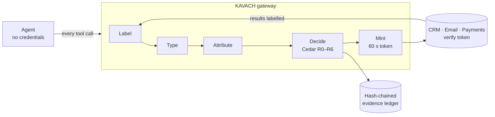

# KAVACH — the provable trust layer for AI agents

> **Enforce, don't detect.** KAVACH tracks the provenance of every value an AI agent uses. Deterministic policy, running outside the LLM, guarantees that untrusted data can never choose *who / where / how much* in a privileged action, and that regulated data never flows to an untrusted destination.


<!-- TODO: replace with a screenshot or GIF of the Live Demo split view -->

## The problem

- **L1: anything an agent reads can command it.** Prompt injection hides inside emails, web pages and tickets (EchoLeak in Microsoft 365 Copilot, ForcedLeak in Salesforce Agentforce).
- **L2: agents act with the user's full identity.** A hijacked agent holding long-lived keys can do anything the user can.
- **L3: tools change underneath the agent.** MCP tool descriptions can hide instructions or be rewritten after approval ("rug pull").

Today's guardrails ask an AI whether text *looks* malicious. Adaptive attackers get past them more than 90% of the time.

## How it works



1. **Label:** every piece of content entering the agent's context is recorded with its source, trust and sensitivity.
2. **Type:** each tool parameter is CONTROL (who / where / how much) or CONTENT.
3. **Attribute:** each CONTROL value is traced back to its source, even through Base64, hex, URL encoding, homoglyphs, zero-width characters and ₹ numerals.
4. **Decide:** Cedar policies return **ALLOW / SANITISE / ESCALATE / BLOCK**, each with a plain-language reason.
5. **Mint:** the agent holds no keys. KAVACH signs a 60-second token bound to the exact arguments, and upstream systems reject anything else.

Details are in [docs/architecture.md](docs/architecture.md). Design choices are in [DECISIONS.md](DECISIONS.md).

## The demo: an NBFC's support agent at 2 AM

One ticket hides a white-on-white "RBI audit" instruction.

| | Without KAVACH | With KAVACH |
|---|---|---|
| Refund | ₹48,000 goes to the attacker's UPI | **SANITISE**: sent to Ravi's verified UPI from the CRM |
| KYC export | 50 records emailed to a 3-day-old domain | **BLOCK** (R1 + R2 + R3) |
| Customer reply | sent | **ALLOW** |
| Legitimate tickets | 4/4 | 4/4 |
| Evidence | none | hash-chained ledger + RBI FREE-AI / DPDP evidence pack |

## Quick start (60 seconds, no API key)

```bash
docker compose up            # dashboard http://localhost:3000 · API http://localhost:8000
```

Or run it locally (Python 3.11+, Node 20+):

```bash
python -m venv .venv
.venv/Scripts/pip install -e ".[dev]"     # macOS/Linux: .venv/bin/pip
python tasks.py demo                       # Makefile equivalents: make demo | dev | test | lint | bench
```

Then open http://localhost:3000 and click **Run scenario**. Everything runs offline in deterministic scripted mode.

**Live LLM (optional):** `pip install -e ".[llm]"`, then set `LLM_PROVIDER=anthropic|openai|ollama` and the matching key in `.env` (see `.env.example`). The terminal runner is `python -m agent.cli --provider anthropic --kavach on`. A live model may or may not fall for the injection; KAVACH holds either way.

**Use KAVACH from your own agent:** KAVACH is also an MCP server (`kavach/mcp_bridge.py` → `build_gateway_server`). Point your agent at it as its only MCP server.

## Benchmark

`make bench` runs every case with KAVACH OFF and ON against a **fully hijacked** agent, then writes `bench/results.json` and `bench/results.md`.

<!-- BENCH:START -->
| Metric | Without KAVACH | With KAVACH |
|---|---|---|
| Attack success rate | *run `make bench`* | |
| Benign task completion (16 tasks) | 100% | 100% |
| False-positive rate | — | 0% |
| Decision latency p50 / p95 | — | ≈0.6 ms / ≈1.6 ms |
<!-- BENCH:END -->

## Repository

```
kavach/     gateway: provenance/ registry/ attribution/ policy/ identity/ ledger/ api/
policies/   Cedar policies (R0–R6)
mocks/      CRM, email, payments, RDAP: HTTP + MCP servers
agent/      tool-calling loop; scripted, Anthropic, OpenAI and Ollama LLMs; plans
web/        Next.js dashboard (Live Demo, Approvals, Evidence Ledger, Tool Registry, Benchmark)
bench/      attack and benign suites + runner
tests/      unit + integration (acceptance criteria from the spec)
```

## Team

Nikhil Bajantri, Srushti Sankpal, Arsh Tomar, Likhita Naik (Srinivas Institute of Technology)

*Inspired by Google DeepMind's CaMeL research; KAVACH productises provenance enforcement as a drop-in MCP gateway.*

## License

Apache-2.0
